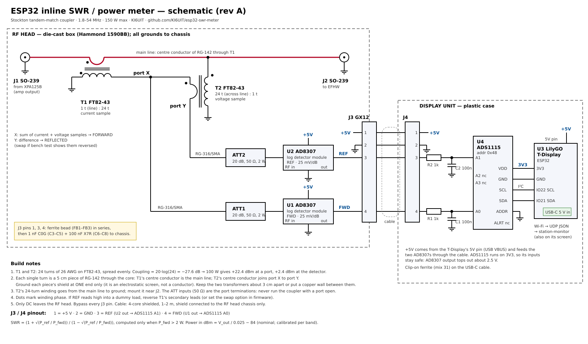

# ESP32 Inline SWR / Power Meter

An inline forward/reflected power and SWR meter for HF and 6 m, read by an ESP32. It goes in
the coax between the amplifier and the antenna, shows watts and SWR on a small screen, and
sends readings over Wi-Fi so other software can log them and raise alerts.

It was built for this station:

```
Hermes Lite 2 ──► Xiegu XPA125B ──► [ this meter ] ──► EFHW
```

The HL2's own SWR reading only sees the amplifier's input, which is always a good 50 Ω load.
This meter sits after the amp, so it sees what the antenna is really doing, at full power.



## How it works

- **Coupler**: a Stockton tandem match. Two FT82-43 toroids with 24 turns each sample the
  line current and voltage. Their sum and difference give the forward and reflected waves, at
  −27.6 dB.
- **Detectors**: two AD8307 log amps, each behind a 20 dB attenuator. Their output is 25 mV
  per dB, so one meter reads accurately from about 1 W to 150 W and still resolves the small
  reflected power of a good match.
- **ADC**: an ADS1115 (16-bit, I²C) instead of the ESP32's built-in ADC, which is nonlinear
  and can't be used on ADC2 pins while Wi-Fi is on.
- **Display and network**: a LilyGO T-Display shows forward power, reflected power and SWR,
  and sends JSON over UDP about 10 times a second.

Only DC leaves the metal RF box. The display unit connects through a 4-wire shielded cable.

## Specs (design targets)

| | |
|---|---|
| Frequency | 1.8–54 MHz |
| Power | 1–150 W (SWR shown above 2 W forward) |
| Insertion loss | negligible; SO-239 in and out |
| Directivity | 25–30 dB on HF, less on 6 m (depends on build) |
| Output | Screen, plus Wi-Fi UDP JSON: `{"fwd_w":98.4,"ref_w":1.2,"swr":1.25}` |

## Documents

- [Parts list](hardware/parts-list.md): every part, with specs, approximate cost and the design
  numbers behind the values
- [Schematic](hardware/schematic.svg)

## Status

- [x] Parts list
- [x] Schematic (rev A)
- [ ] Build and bench test (directivity with a dummy load)
- [ ] T-Display firmware (PlatformIO)
- [ ] Per-band calibration
- [ ] Integration with station-monitor (per-band SWR baselines and alerts)

## Safety

This meter only measures. It doesn't protect the amplifier; the XPA125B's own SWR protection
still does that. Never transmit with the coupler's sample ports open; the attenuators are their
50 Ω terminations.

## License

[MIT](LICENSE)
